# McKinley Maintenance Hub: User Guide

**Maintenance Hub** turns resident maintenance requests into a ranked, routed, translated work plan. It has four views, one for each person involved:

| Who | Opens | What they do |
|---|---|---|
| **Resident** | Resident app: `/resident/` | Sends requests, gives permission to enter, follows each repair |
| **Supervisor** | Staff app: `/` | Ranks and approves work, follows up, plans routes, turns and maintenance |
| **Technician** | Staff app: `/` | Sees their own jobs in their own language, reports progress |
| **Property manager** | Staff app: `/` | Everything a supervisor sees for their properties, plus sign-in PINs and codes |

**Live links**
- Staff app: https://mckinley-maintenance-hub.rossbusinesstech.here.now/
- Resident app: https://mckinley-maintenance-hub.rossbusinesstech.here.now/resident/

**Demo sign-ins** (sample data only)

| Role | Sign in with |
|---|---|
| Resident | Property **Bella Casa**, unit **150**, code **0108** |
| Supervisor | **Luis M.**, PIN **1203** (Orlando properties) |
| Technician | **Carlos** 2107 · **Alicia** 2108 · **Terrence** 2109 (see the Access tab for others) |
| Property manager | Staff sign-in → **🏢 Manager** → `orlando-demo` (also `annarbor-demo`, `ypsilanti-demo`, `winterpark-demo`) |

All names, residents, technicians and vendors are made up. Properties, addresses and site maps are McKinley's.

---

## 1. Signing in

The staff app opens on the **staff sign-in**. Choose Supervisor, Technician or Manager, pick your name and enter your PIN. A manager enters their passcode instead. On the team's members-only site, staff can sign in with their work email instead.

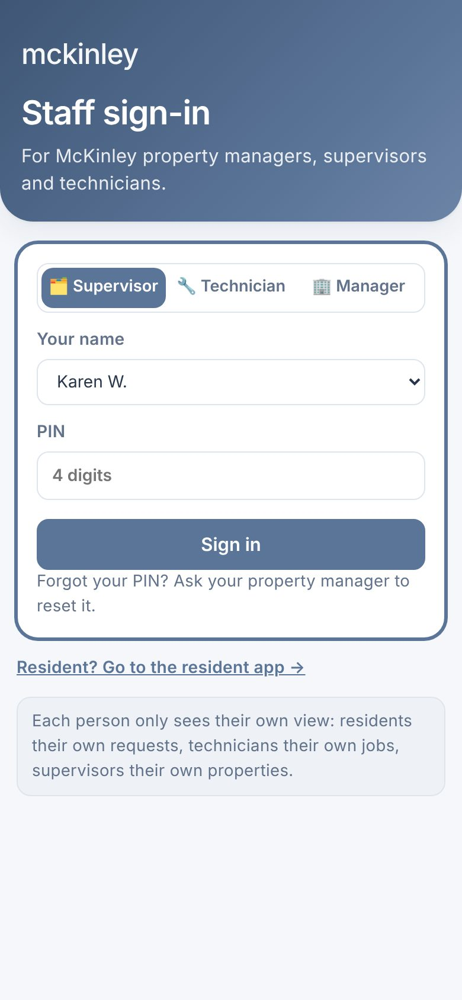

Residents use the **resident app**. They choose their property, type their unit number and their 4-digit code: the last 4 digits of the phone on their lease, unless their manager set a different one. No list of residents or apartments is ever shown.

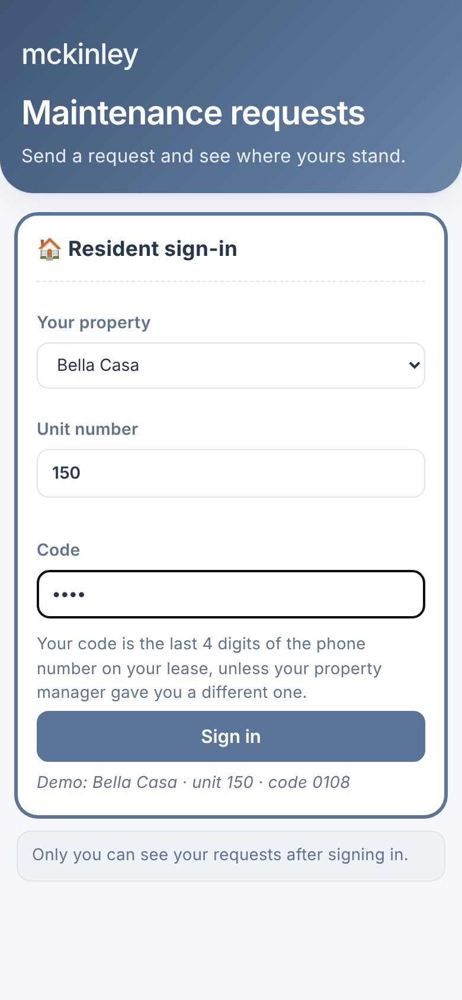

---

## 2. Resident: send a request

1. Tap **New request**.
2. Describe the problem and where it is. Typed or spoken unit numbers both work ("building eleven unit four").
3. Optionally tap **📷 Add photos**. A photo helps the technician bring the right tools.
4. Tap **Send to maintenance**.

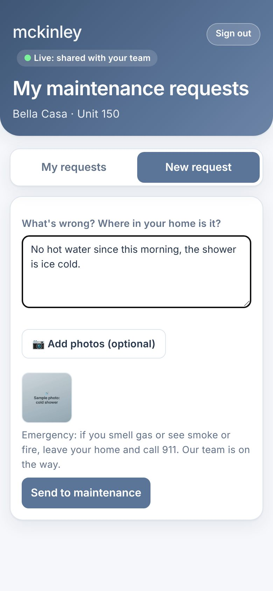

The request appears under **My requests** with a 6-step tracker: **Received → Approved → Scheduled → On the way → Working → Fixed**. If the team needs permission to enter, the resident taps **Yes, you may enter**. If information is missing, they can reply right on the card.

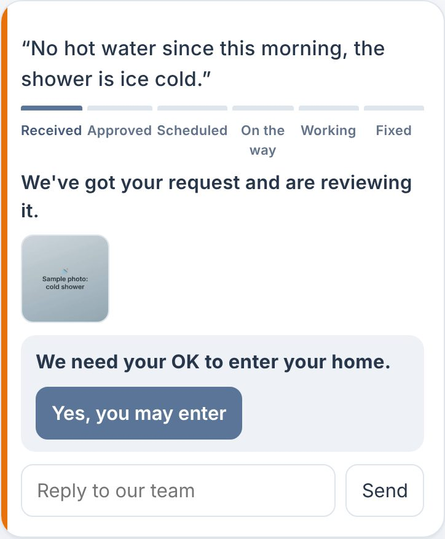

Spanish-speaking residents see the whole resident app in Spanish.

---

## 3. Supervisor: rank and approve

The **Priority** tab lists every request at your properties, most urgent first:

- **Severity 1–5:** 5 Emergency (gas, fire, flooding, no heat in Michigan), 4 Urgent (no AC in Florida, no hot water, lockout), 3 Soon, 2 Routine, 1 Cosmetic. Fixed rules decide the minimum. An AI reading can raise a level but never lower it.
- **Emergencies** get **📍 Go now** (directions), **Call** and **✓ Done** buttons, plus **📟 Page [tech]** after hours.
- **Tags** show entry rules, pets, repeat problems, vendor needs and the technician.

On a laptop, the left side holds the tabs, the property picker, the day and **Regular hours / After hours** switch, who's working or on call, and the **Team hours** chart.

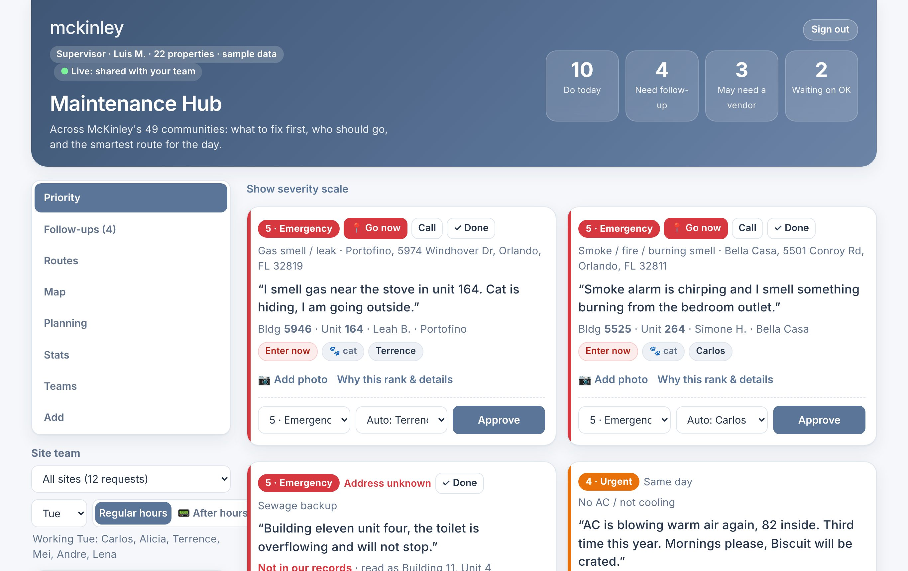

A resident's request arrives tagged **From resident app**, with its photo:

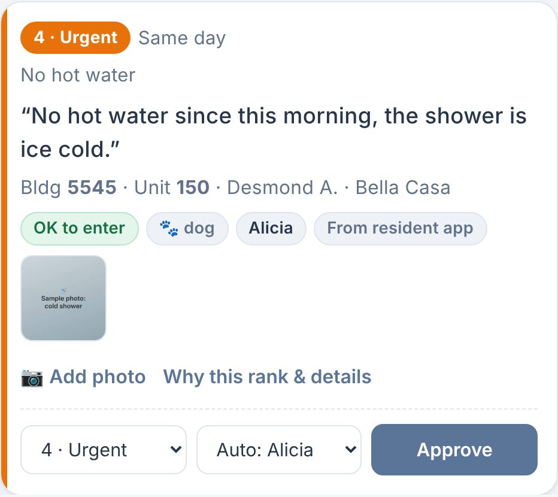

Tap **Approve**. The technician shown is **locked in** and the card says **👷 Assigned to [name]**. A work order appears in that technician's language, ready to text to them. You can change the priority or technician with the menus on the card.

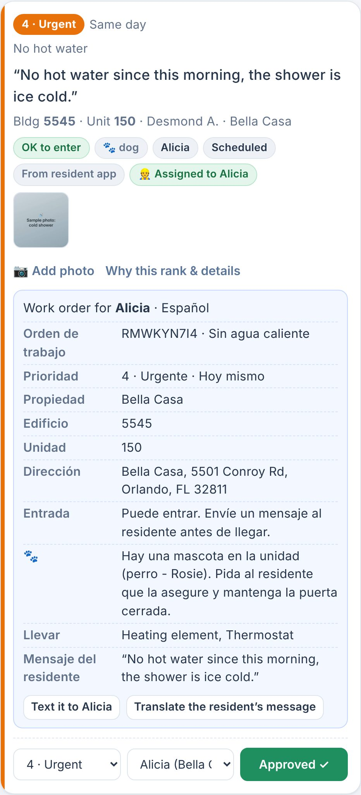

**Why this rank & details** explains the ranking, entry rules, pets, tools to bring and parts used. For vendor jobs it adds a one-tap **Email request** to the right vendor and a tracker for status, visit date, quote and cost.

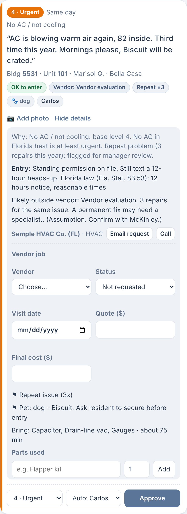

---

## 4. Supervisor: follow-ups, routes and maps

**Follow-ups** lists requests that are missing something: unit number, details or permission to enter. Each has a ready-to-send message. **Text**, **Email** and **Call** open your phone's own app with the words filled in, and you can alert the leasing office instead.

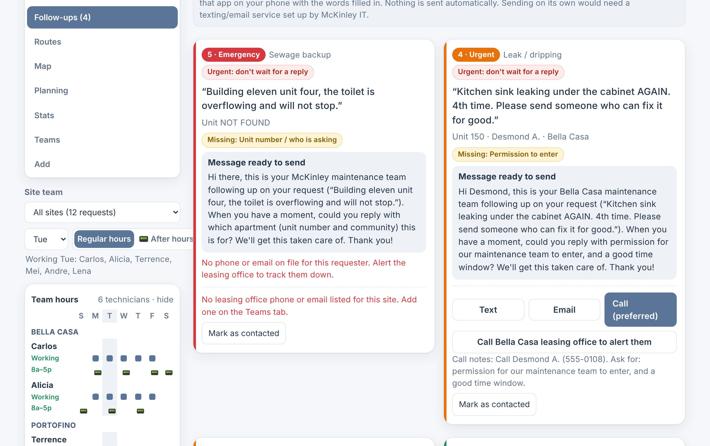

**Routes** shows each technician's day in order: emergencies first, then the nearest buildings, fitted to residents' entry windows. Each stop shows its live status and the plan shows minutes of driving saved.

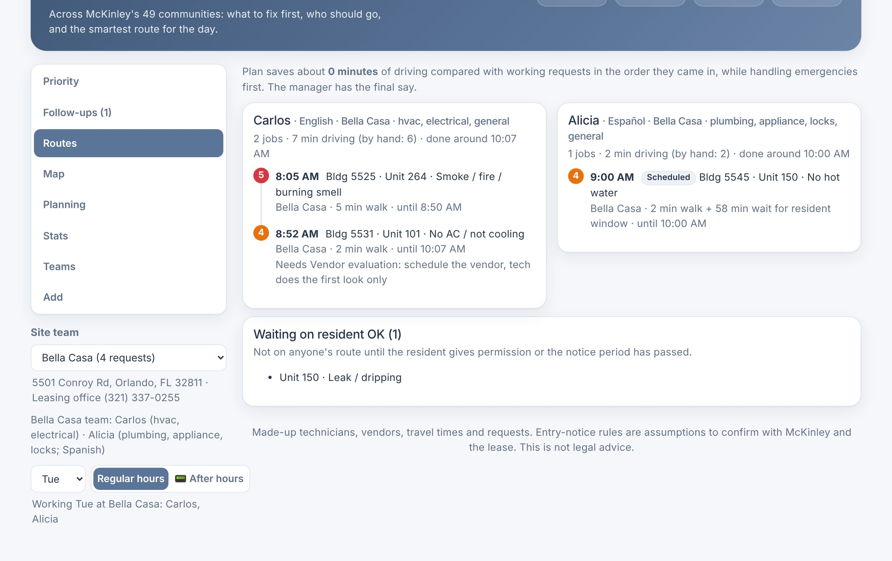

**Map** shows the property's site plan with numbered stops and each technician's route. L marks the leasing office and M the maintenance shop. Tap a dot for the job.

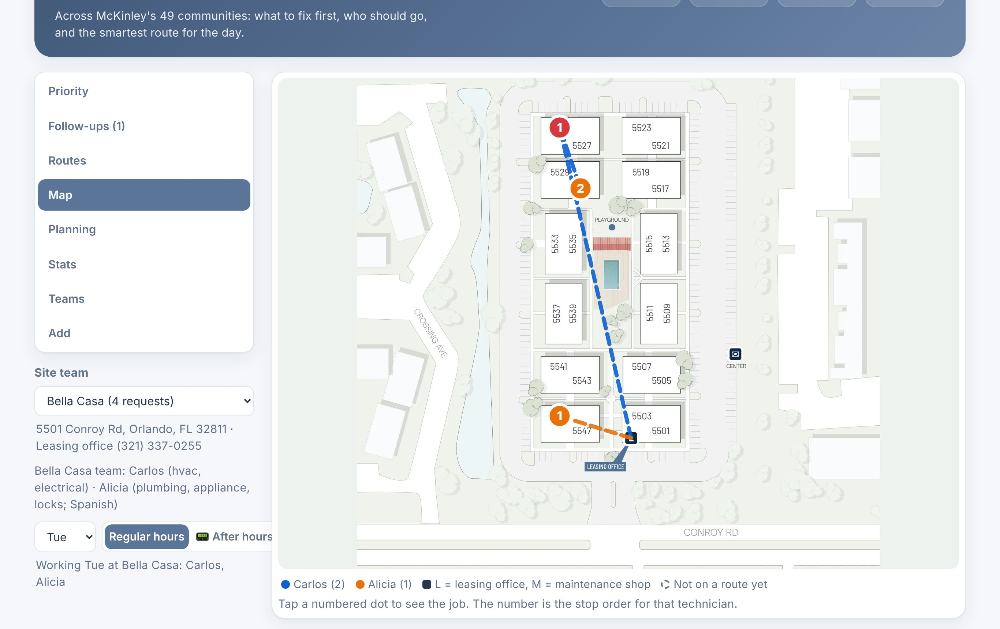

---

## 5. Supervisor: planning, stats and teams

**Planning**
- **Move-outs and turns:** residents who gave notice or whose lease is ending. **Plan turn** creates a 9-step make-ready checklist with dates and technicians. **Edit** lets you change any date or task, before or after planning, and **+ Add a move-out** works for any unit.
- **Preventive maintenance:** suggestions such as Michigan furnace checks, Florida AC tune-ups, smoke and CO alarm tests, and repeat-problem inspections. You can also add your own. Affected residents see the visit date in their app.

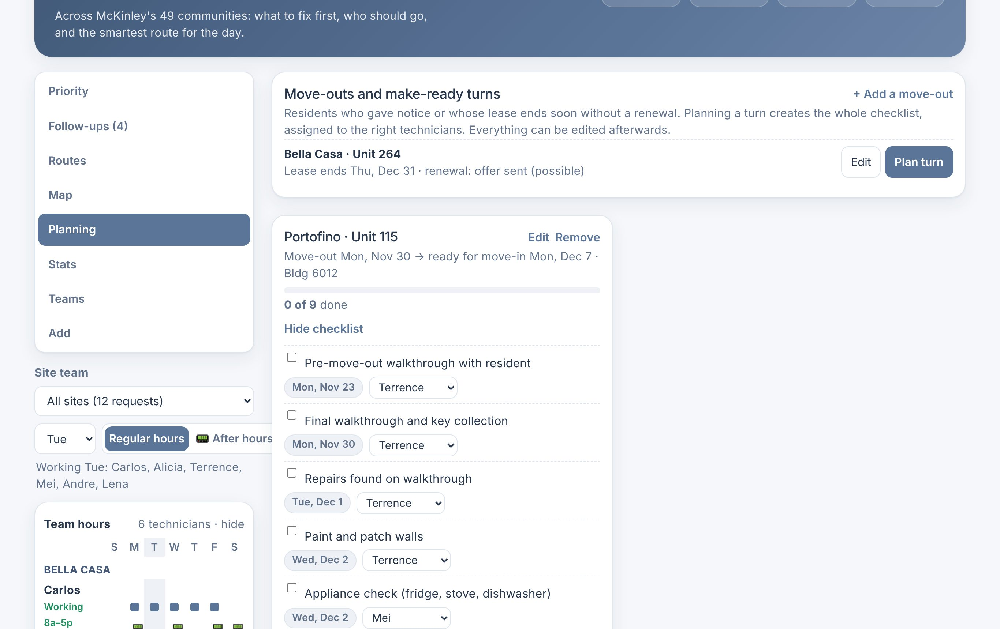

**Stats** opens with the **🏆 Scoreboard**: approval-to-on-the-way time, jobs finished, first-visit fix rate, residents saying "fixed", driving saved, jobs waiting and vendor spend. Below it are charts of repeat problems by unit, problem type, property, days to fix and parts used.

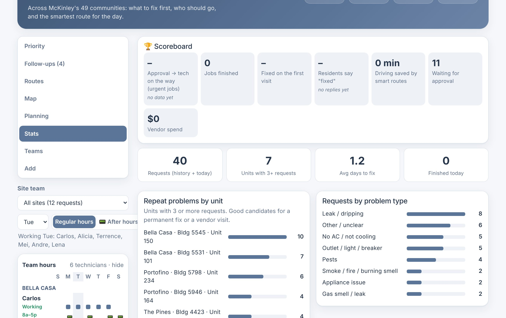

**Teams** is where you set up supervisors, vendors and each property: leasing office contact, site map, and each technician's skills, language, sites, shifts and on-call days. A new property can't be added without its site map. After adding it, tap the map to mark buildings, the leasing office and the maintenance shop.

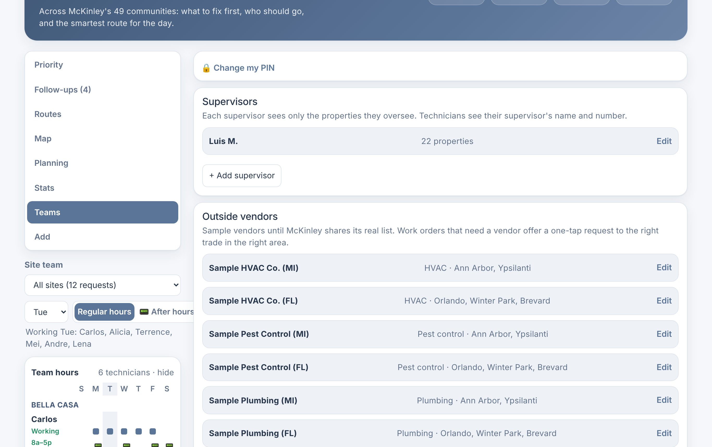

---

## 6. Technician: my day

Technicians see only their own approved jobs, in route order and in their own language. Built in are Spanish, Portuguese, French and Haitian Creole; other languages get a Translate button. **Planned work** lists their turn and maintenance tasks. Days off can be requested at the bottom of the screen.

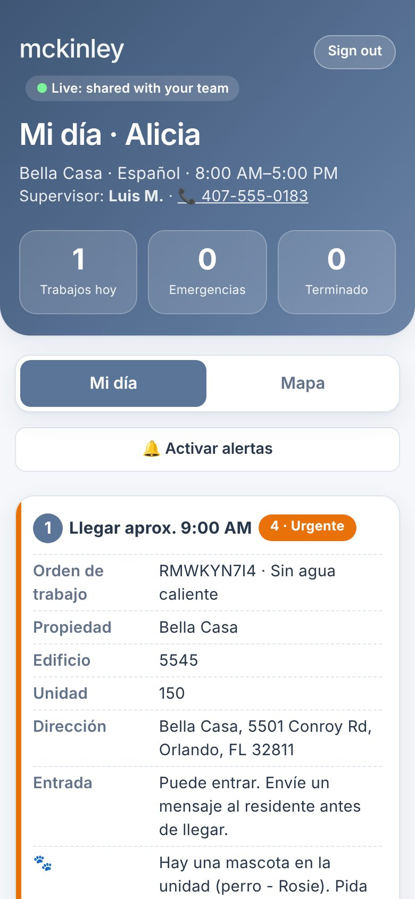

On each job:
1. **🚐 On my way**, then **🔧 Started**, or **📦 Waiting on parts**.
2. **📍 Directions**, **Call resident**, **Translate message**, **📷 Add photo**.
3. Log **parts used**.
4. Tap **Done**. The supervisor and the resident see it right away.

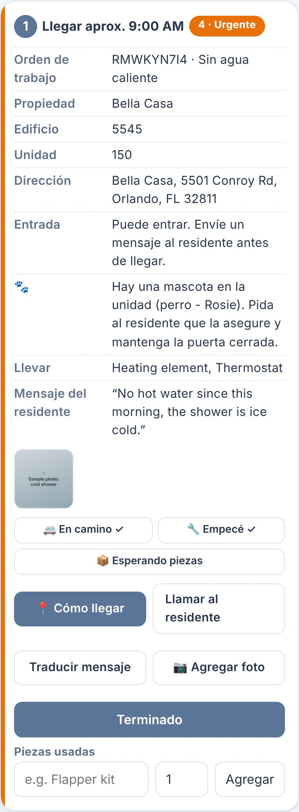

Routine jobs approved after hours show as **Next shift**, so nothing disappears.

---

## 7. Resident: follow the repair

The tracker updates as the technician works. For example: *"Alicia is working on it now."*

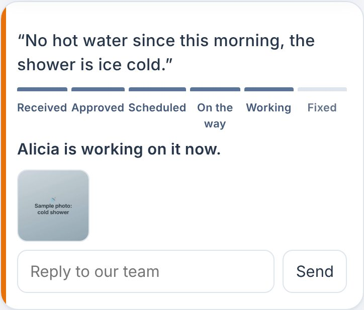

When the job is done, the resident answers **Is it fixed?** The supervisor sees **Resident: fixed ✓** or a red **still a problem** tag.

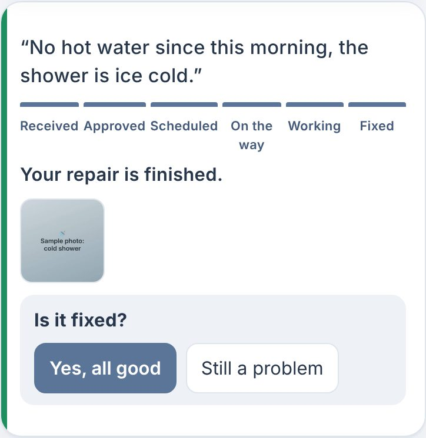

---

## 8. Property manager: access

Each property manager is set by IT and sees only their own properties. On the **Access** tab they can **Show**, **Set** or **Reset** PINs for their supervisors and technicians, set residents' codes, and change their own passcode. Everyone can also change their own PIN from their screen.

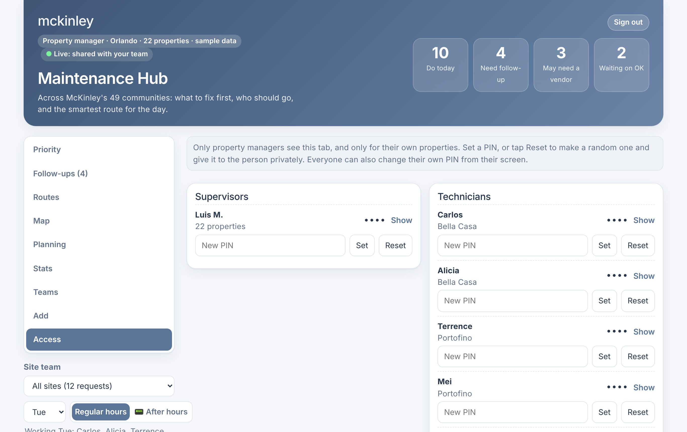

---

## Good to know

- **Live sharing:** on the team site, every change reaches every phone and computer within a few seconds, and the header says **● Live: shared with your team**. If a page says *Saved on this device only*, it's an old test link or an old copy of the page: open the live link above and refresh.
- **Employee sign-in:** staff sign in with name + PIN on any device; PINs are managed on the property manager's Access tab. On a members-only here.now site, staff can sign in with their work email instead.
- **Messages:** Text, Email and Call buttons open the phone's own apps with the message written. Nothing is sent automatically.
- **Assumptions to confirm with McKinley:** the severity scale, entry-notice hours (Florida 12, Michigan 24), on-call hours, vendor list and preventive maintenance rules. This is not legal advice.
